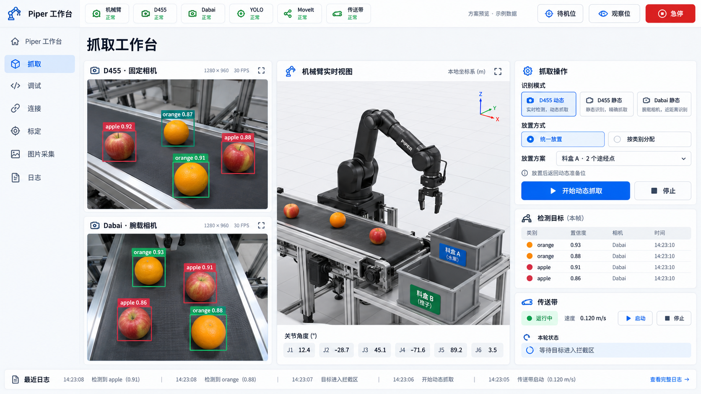
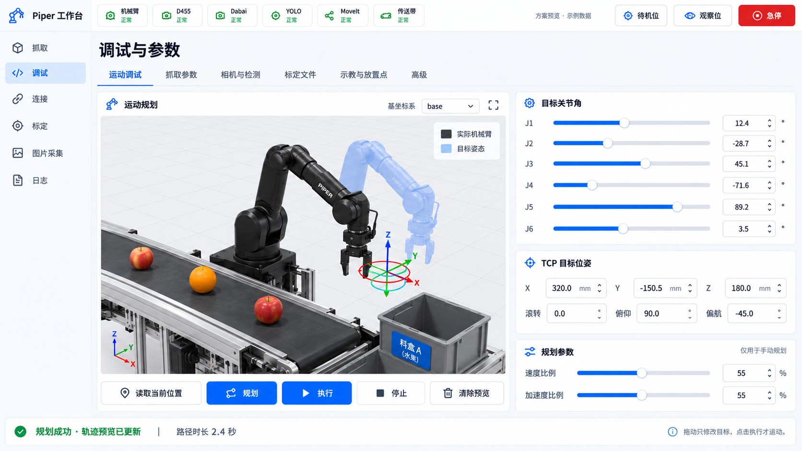
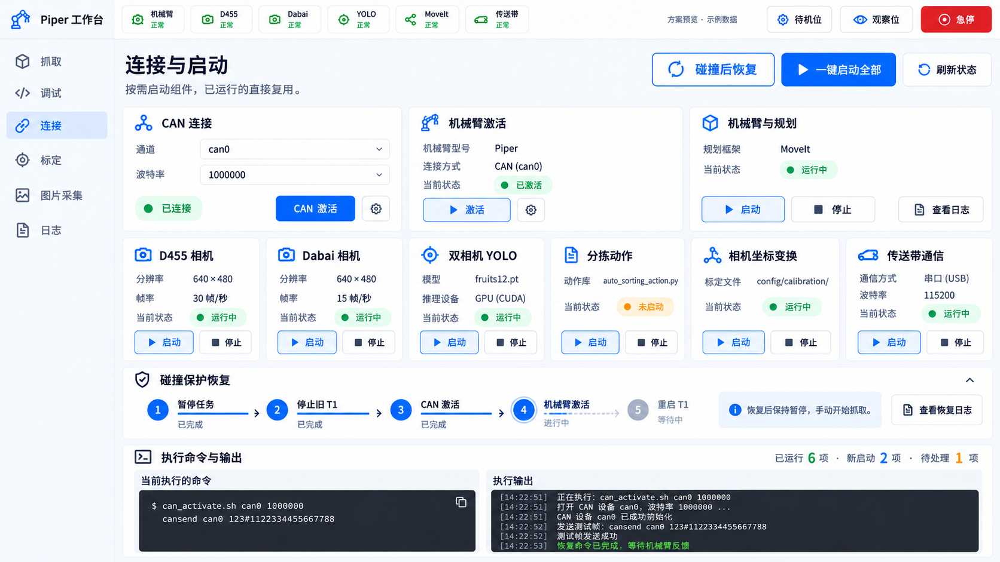
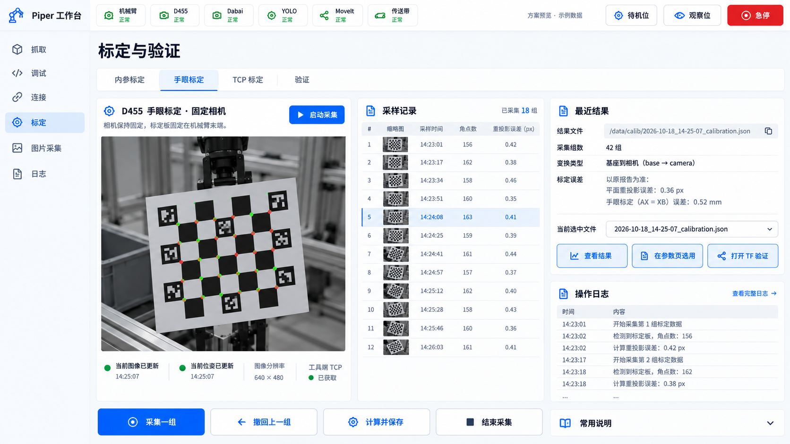
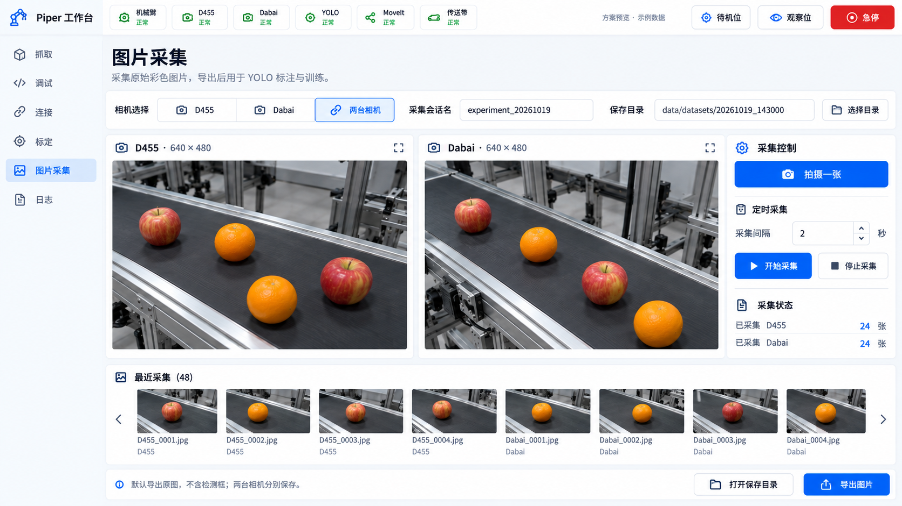
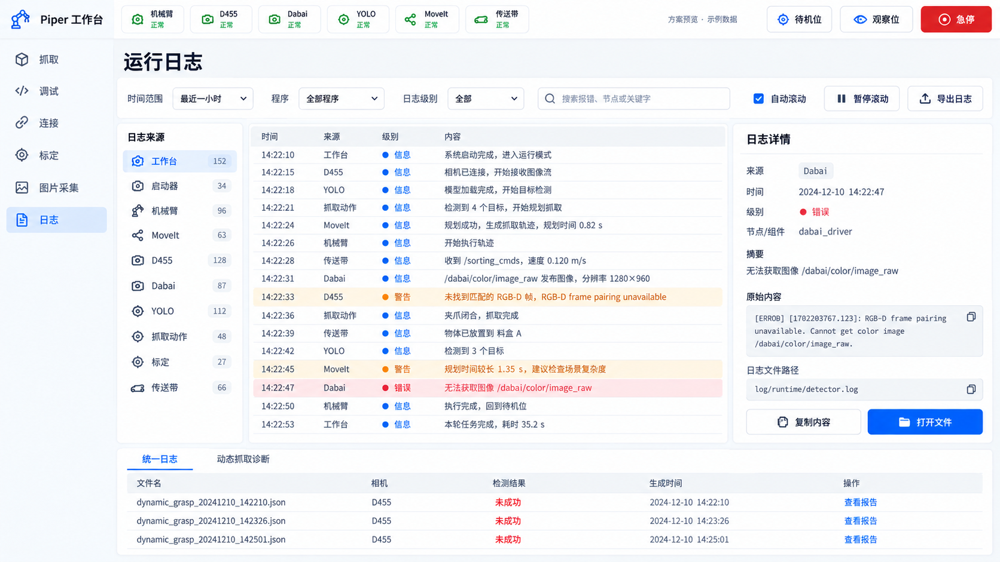

# Piper 抓取工作台详细实施与交接计划

> 执行 agent：使用 superpowers:executing-plans，按本文任务逐项实现。用户已指定交给另一个 agent 执行，本次会话只制作计划与设计。默认由接手 agent 顺序执行，不自动派出子代理。

**目标：** 将已实现的 Piper 抓取、连接、调试、标定、验证、采图和日志整合为中文桌面工作台，复用现有后端，保留动态抓取性能。
**架构：** Qt 5 Widgets/C++ 前端嵌入原生 RViz/MoveIt；常驻 Python 本地服务复用运行启动器、现有动作、标定和传送带代码；两台相机持续检测，抓取按模式选择数据。
**技术栈：** Ubuntu 22.04、ROS 2 Humble、Qt 5.15、rviz_common、moveit_rviz_plugin、C++、系统 Python 3、rclpy、现有 YOLO 环境、Unix 域套接字、PTY。
**配套规格：** [产品、架构与界面规格](../specs/2026-10-19-piper-workbench-design.md)。本文和规格必须一起阅读，图片在本文第 5 节。
**日期：** 2026-10-19，Asia/Shanghai。
**状态：** 需求讨论和主页视觉方向已确认；其余页面为本次生成的设计参考，尚未逐页经用户确认；软件未实现，未启动实机。

## 1. 给接手 agent 的第一条指令

先阅读本文、配套规格和仓库 AGENTS.md，使用自己的独立 worktree。不要从旧交接文档的四页 tkinter 外壳建议直接开工。此次用户已经将范围扩展为六页中文 Qt 桌面软件、真实三维操作、双路同时检测和示教放置。

按“核对现场基线 → 最小原生三维骨架 → 后台控制与双路视觉 → 抓取/放置 → 标定 → 其他页面 → 桌面交付”推进。用户已认可主页风格，不要另起视觉方案。其余预览用于说明方向，实际数据与交互以文字规格为准。

不要把前端做完而让按钮仅打印文字，也不要因为系统没有全绿而禁用无关功能。每项任务交付可操作结果并记录尚未现场验证的部分。

### 1.1 全局约束

- 用户是机器人工程本科生；首次出现跨领域概念时，用简单语言解释。
- 优先复用现有环境、源码、开源 RViz/MoveIt 接口；没有必要逆向 RViz。
- 主目录 /home/lxf/agx_arm_ws 为部署与集成目录，保留未提交修改和暂存区。
- 所有编辑、构建、日志、采样在本会话/执行会话自己的 worktree；共享权重和 Python 环境只读。
- 文件存于已核对的 /home 数据盘，不能擅自迁入系统分区或安装系统级依赖。
- 不添加全系统健康、标定审批、程序存在性等新门禁；各组件能单独操作。
- 不修改动态预测/拦截算法、现有抓取成功判定、默认动作参数或驱动硬件配置来“顺便优化”。
- 用户要求“尽量显示中文”；所有普通导航、按钮、状态、参数名称和提示使用中文。
- 图标不使用 Emoji；原始日志、代码标识、路径、话题名、模型类别名保留原文。
- 清理只针对本任务确认无用的文件，优先 gio trash；标定、样本、模型、构建环境不误删。
- 不增加全量测试门禁或重复冒烟；只进行与本次改动相关的验证。

### 1.2 交接目录和版本

本次计划制作工作树：/home/lxf/.codex/worktrees/f142/agx_arm_ws
计划分支：codex/workbench-design-20261019
当前抓取提交：100977f4，release: freeze user-accepted Piper dynamic grasping (2026-10-19)。

本次只创建文档、预览资产和设计材料，不修改抓取代码、不更新主目录、不启动硬件。执行者若在另一个 worktree，先将本计划及资产带入，再从最新已确认抓取提交继续；不要机械使用 AGENTS.md 中过时的 2026-10-17 基线覆盖当前版本。

旧参考交接：/tmp/codex-handoff-workbench-20261019.md。它只提供历史背景，其中“一相机一检测器互斥”“四页外壳”“下一会话需确认开工”等内容已由本轮明确需求替代。

### 1.3 核查重点

| 易错条件 | 预期行为 | 所属任务 |
|---|---|---|
| 双路 track_id 重号、Dabai 话题曾映射到根话题 | 严格按相机与会话区分，D455 不抓 Dabai 坐标 | 任务 4 |
| 已启动部分组件、一台相机无图 | 复用已有组件，其他功能仍可操作，不全局锁住 | 任务 3、4 |
| 在动态多物体循环中关窗 | 当前一个物体完成后暂停，不继续抓完整批 | 任务 5 |
| 现场新格式与发布版标定差异 | 现场脚本和样例文件优先，保留原候选和来源 | 任务 1、8 |
| 修改目标或应用标定后界面值变化 | 明确实际生效状态；规划/执行不使用过期目标 | 任务 6、7、8 |
| 碰撞后 T1 仍在刷未连接警告 | 提示连接异常；手动恢复强制重做原流程，不被“进程存在”跳过 | 任务 3、5、10 |

## 2. 范围与最终行为

### 2.1 页面

1. 抓取：D455 动态、D455 静态、Dabai 静态，双画面、三维、目标、放置方案、传送带和状态。
2. 调试：末端拖动、关节值、规划/执行、各组参数、标定文件、示教和高级旧功能。
3. 连接：CAN、激活、节点与相机独立启动，一键补齐缺少组件，碰撞后恢复，原始命令与输出。
4. 标定：两相机内参与手眼、公共 TCP、所有对应验证程序的图形化入口。
5. 图片采集：单张、定时、单/双相机原始彩色图，分目录和导出。
6. 日志：各组件完整输出、筛选、搜索、导出、动态抓取 JSON 诊断。

### 2.2 抓取模式矩阵

| 模式 | 相机数据 | 操作 | 正常放置后返回 |
|---|---|---|---|
| D455 静态 | D455 | 单次＋连续自动分拣，沿用现有停带流程 | 可示教保存的待机位 |
| Dabai 静态 | Dabai | 点选目标、单次抓取 | 可示教保存的 Dabai 观察位 |
| D455 动态 | D455 | 现有持续供带、连续拦截 | 原流程得到的动态准备位，等下一目标 |

两相机持续采集和 YOLO，切换模式不重启相机或检测器。动态失败与急停仍走原处理，不因正常返程需求而向错误路径追加动作。

### 2.3 位置和参数

放置方案包括名字、0～5 个去程关节途经点和一个释放终点；支持统一方案和按类别分配，未匹配类别使用默认方案。通过实体按钮进入示教，界面读取实际关节角保存。待机与 Dabai 观察位同样可改。

每个物体开始前取得配置快照，正在执行的动作不被后续编辑改变。下一物体读取新选择。原放置点、待机位、观察位必须在首次启动时导入，不要求用户重录。

速度设置分开：手动规划速度、静态抓取参数、动态 config/dynamic_grasp.json，不能用一个“全局速度”悄悄改所有流程。

### 2.4 启动与关闭

一键启动执行当前系统需要的原 CAN→激活→机械臂/动作流程，以及双相机、TF、YOLO、传送带通信；已运行且配置满足需求的复用。每个组件仍有独立按钮。失败只报告受影响项，不自动停止已成功的其他组件。

关闭软件窗口：完成当前一个物体后暂停连续任务，按原任务停止传送带，T1/T5、相机、YOLO 等节点仍运行。下次打开接回状态，不自动恢复抓取。关闭 Codex 不影响软件。

### 2.5 新增：碰撞后恢复与警告识别

用户实际人工恢复顺序为重新激活 CAN、重新激活机械臂、重新打开 T1。连接页提供独立“碰撞后恢复”按钮，主页连接异常状态有跳转入口。完整顺序为“暂停派发并停带、取消旧目标/清队列 → 退出旧 T1 → 原 CAN 命令与 cansend → activate_robot.py → 用当前 TCP/模型重启 T1 → 刷新动作状态、保持暂停”。不默认重启相机/YOLO/T5，不额外自动回零或放下物体。

恢复与普通一键启动的区别必须写进实现：普通启动复用已运行组件；恢复不能因为 can0 为 UP、激活脚本曾运行、T1 PID 仍存在就跳过。原 can_activate.sh 本身可能报告接口已 UP，这是原脚本行为；仍执行后续 cansend 和激活序列，不另造 CAN 命令。

T1 记录此消息时提示“机械臂连接异常，建议执行恢复”：

~~~text
[agx_arm_ctrl_single-1] [WARN] [1792350746.520460978] [agx_arm_ctrl_single_node]: Agx_arm is not connected, cannot control
~~~

源码位置：agx_arm_ctrl_single_node.py 的 _check_can_control。在 _check_arm_ready 返回 false，即关节反馈不存在或 hz≤0 时输出；它表示驱动判断未连接，不唯一证明碰撞。单条当前实例日志就能触发提示，重复聚合显示次数，原始输出不丢。只跟踪当前 T1 的实时日志或 /rosout，历史浏览不触发。未使能/示教模式警告分开解释。

恢复仍由用户点击，不能因警告自动重新使能。页面提示移开碰撞障碍，不加确认门禁；相机、采图、文件管理与日志不受影响。恢复完成与已重新使能分别真实显示，不能仅凭命令 exit=0、PID 存在或未填充的 err_status=0 就宣布成功。详见规格 3.4。

## 3. 当前仓库事实与复用表

以下为 2026-10-19 只读核查结果，不是新增实现：

| 现有模块 | 复用内容 | 必要调整 |
|---|---|---|
| sorting_gui_client.py | 任务派发、自动分拣/动态控制、串口状态、曝光/夹爪指令、旧队列和坐标逻辑 | 将非 UI 逻辑抽入后台服务；不把 Qt 页面塞进旧 tkinter 文件 |
| runtime_launcher.py | build_command、ensure_background、stop_component、状态和运行登记 | 增加 workbench/service 和双路检测的启动/状态支持 |
| runtime_process_manager.py | PID 身份、锁、单实例、所有权和进程组 | 复用，不重写进程管理器 |
| scripts/run_component.sh、runtime_env.sh | 已有解释器和 ROS/Orbbec/DDS 环境 | 保持单一环境入口，双路检测也需加载 Orbbec overlay |
| vision/realsense_yolo_node.py | 已有双相机 CameraState、单 YOLO 模型、独立发布者、逐路曝光 | 双路默认启动，补帧边界阈值更新、Dabai 文件内参、分路异常隔离 |
| auto_sorting_action.py | 静态抓取、命令和状态、现有动作发送 | 双路缓存、放置解析、按模式返回、本轮后暂停 |
| dynamic_grasp_runtime.py | 已验证动态规划与动作、准备位记忆、诊断输出 | 仅接放置去程/返准备位；不重写预测和随动 |
| stm32_conveyor.py | STM32Conveyor、串口协议、启停/方向/状态 | 后台服务唯一持有；UI 关闭后保留收尾能力 |
| 主目录 handeye_calibration_ros | 这两天现场采集、求解、图像订阅和文件格式 | 按样例逐项迁入工作树，PTY 图形化包装，少量结构化进度 |
| tools/calibration/approve_calibration.py | 文件备份、替换、manifest 来源记录 | 新 GUI 的“应用”不增加审批；保留质量原文、不伪装通过 |
| RViz/MoveIt 原生库 | 真实模型、TF、交互标记、目标状态、轨迹预览 | 用 Qt 原生嵌入，中文外层控制 |

### 3.1 必须注意的现有缺口

- 旧 GUI 切换相机会停止另一检测链路，不能直接复用这个切换方法。
- Dabai 旧单路 detector 启动会 remap 到 /detection_info；双路时禁止这样映射。
- 视觉节点已有双路逻辑，但一个定时器顺序推理；不是两份 YOLO 模型。
- 当前视觉热更新回调只处理部分补偿，不代表置信度、IoU 等全部参数已经在线生效。
- 当前 D455 可从活动文件读 K/D；Dabai 默认以驱动 CameraInfo 为主，需补足用户选择文件后真实使用的能力。
- 旧 TCP 验证会因 T5/T6 节点存在而拒绝启动；工作台常驻后这个旧条件必须适配。
- TCP 改动需要 T1 的 SDK 和 MoveIt 模型一起重新加载，不能只改界面或 ros2 参数。
- 旧 GUI 父进程退出会清理 session；新工作台服务不能原样继承此生命周期。
- 碰撞后可能仍有 T1 PID 和 CAN UP，但控制已失效；恢复入口必须独立于普通启动的复用分支。
- _check_can_control 的未连接警告是可用故障线索；AgxArmStatus.err_status 虽在消息中声明，但当前发布代码未给该字段赋值，不能据默认 0 判正常。
- 旧文档包含历史“Dabai 未接入”“内参只用于标定”等描述，须以当前源码与近期样本为准。

### 3.2 现场标定基线处理

用户明确选择主目录现场流程，并补充“实际标定要俺这两天在使用的格式”。因此：

1. 读取主目录当前校准脚本和最近样本；保留主目录未提交差异。
2. 只在自己的 worktree 接入相应校准模块，不复制整棵主目录。
3. 包含手眼/内参 qos_profile_sensor_data 的现场修正，按同一套导入依赖调整。
4. 主目录 TCP 验证移除了发布版 continuous-round/18 秒整轮工具；本次以主目录既有 sweep 流程为基准，不重新引入删除的 tcp_trajectory_tools。
5. 原始候选、用户采用副本、活动文件分别保留；任何质量标签差异都记录真实来源。
6. 当前主目录其他删除文档、参考 PDF、历史报告等不属于本次产品改动，不顺便同步删除。

## 4. 接口、文件和进程约定

### 4.1 计划新增文件布局

这是未来实现位置，不表示文件已经存在：

~~~text
src/piper_workbench/                 Qt5/C++ ament_cmake 包
  CMakeLists.txt, package.xml
  src/main.cpp, main_window.cpp
  src/rviz_panel.cpp, ros_view_bridge.cpp, backend_client.cpp
  src/pages/                        六页；调试子页按职责拆分
  include/piper_workbench/
  resources/                        QSS、中文文案、图标
  launch/workbench.launch.py         传入与当前 T1 一致的模型/运动学参数
workbench/                          Python 后台，按功能组织
  service.py, protocol.py
  ros_adapter.py, tasks.py
  components.py, settings.py, placement.py
  calibration.py, capture.py, logs.py
scripts/start_workbench.sh
config/workbench/settings.json
config/workbench/placements.json
config/workbench/workbench.rviz
config/workbench/calibration_verify.rviz
assets/desktop/piper-workbench.desktop.in
tests/test_workbench_*.py            只覆盖关键行为
~~~

控制服务 socket 为当前工作树 .runtime/workbench.sock；PID/日志遵循原 ProcessManager 目录。不要再引入 HTTP 服务、数据库、前端打包器和浏览器依赖。文件可以按职责合并小模块，但不能将所有页面和后端集中成另一个巨型文件。

### 4.2 本地控制协议

每行一个 JSON，对象格式：

~~~json
{"id":"请求ID","op":"component.start","args":{"component":"camera","camera_id":"dabai"}}
{"id":"请求ID","ok":true,"result":{"state":"running","reused":false}}
{"id":"请求ID","ok":false,"error":{"message":"中文错误摘要","detail":"原始错误输出"}}
{"event":"component.status","data":{"component":"camera","camera_id":"dabai","state":"running"}}
~~~

固定动作：

| op | 参数/结果要点 |
|---|---|
| status.get | 当前组件、任务、配置生效状态快照 |
| system.start_missing | 检查并启动缺少组件，返回逐项 spawned/reused/error；不自动抓取 |
| arm.recover | 手动发起完整恢复，强制原 CAN/激活/T1 重启；返回恢复会话和逐步结果，不自动续抓 |
| component.start / component.stop | component、camera_id；使用原 launcher |
| motion.send | 原 sorting 命令，保留相机/track/session 元数据 |
| motion.pause_after_cycle | 不发下一物体；不取消在途抓取 |
| parameters.get / parameters.apply | 分组值，返回 applied/pending_restart/error |
| poses.capture | 读取实际关节和 TCP、时间，结果不自动执行 |
| placements.save | 保存完整方案与映射，返回版本时间 |
| calibration.start / calibration.input | 类型/相机/参数；输入 capture/undo/solve/finish 对应 Enter/d/q/c |
| calibration.apply | 已存在结果路径、类型、相机；返回实际受影响组件和生效状态 |
| capture.once / capture.start / capture.stop / capture.export | 相机列表、间隔、会话/导出目录 |
| logs.subscribe / logs.export | 来源、时间、级别、关键字；原文不改写 |
| session.close | 请求当前物体后暂停，然后 UI 断开 |

事件至少包括 component.status、task.status、arm.reconnect_required、arm.recovery.progress、calibration.progress、calibration.result、capture.progress、log.batch、settings.applied。请求和响应 ID 对应；后台不能把日志行混入 JSON 响应。日志按小批量发送；图像由 ROS 直接发送给前端。

### 4.3 Python 核心边界

~~~python
def ensure_missing_components() -> list[dict]: ...
def recover_arm_connection() -> dict: ...
def resolve_placement(class_name: str, camera_id: str, settings: dict) -> dict: ...
def capture_actual_pose() -> dict: ...
def request_pause_after_cycle() -> None: ...
def apply_parameter_group(group: str, values: dict) -> dict: ...
def start_calibration(kind: str, camera_id: str | None, options: dict) -> str: ...
def send_calibration_input(session_id: str, action: str) -> None: ...
def apply_calibration(kind: str, camera_id: str | None, source_path: str) -> dict: ...
~~~

resolve_placement 返回方案 ID、名称、via_joints_rad、release_joints_rad、normal_return_joints_rad、来源/快照时间。动态准备位仍来自 node._dynamic_ready_joints；若当前不存在，遵循原准备逻辑，不用零位兜底。

动作节点增加 /workbench/control（std_msgs/String）控制消息，至少支持 pause_after_cycle、clear_pause、recovery_prepare、recovery_complete；它直接更新控制状态，不排到长时间动态循环之后。recovery_prepare 取消遗留目标并清空队列，不能调用会自动开夹爪/回待机的 reset 分支；recovery_complete 重新接入新 T1、清遗留状态但保持任务暂停。急停仍走原 /emergency_stop。新的连续任务明确开始时清除 pause；打开窗口本身不清除。

每个目标开始时调用统一的放置解析；动态循环内部对每个新目标读取最新工作台设置，而不是整批只用第一次的类别。现有 CLI 命令未携带工作台设置时保留原默认放置兼容。

### 4.4 Qt 与 RViz 边界

- Qt 主线程只处理界面，ROS executor 在独立线程，跨线程使用 queued signal。
- RvizPanel 负责原生可视化、真实反馈、目标状态和预览；BackendClient 负责本地控制请求。
- MotionPlanningDisplay 的 getQueryGoalState、setQueryGoalState、queryGoalStateChanged 作为拖动与 J1～J6 的统一目标。
- 自定义中文规划/执行按钮通过 MoveGroupInterface 使用上述目标；不调用插件私有 slot，不通过屏幕点击或坐标自动化控制 RViz。
- 手动规划工作放在工作线程，执行已有成功规划的 RobotTrajectory。修改目标即使旧预览仍显示，也标记“目标已修改，请重新规划”，不执行旧轨迹。
- 主页与运动调试页共用一个 RViz 实例，切换宿主区域时保留视角与场景；主页隐藏交互目标，调试页显示交互标记。
- /feedback/joint_states 代表实际状态；禁止用 /control/joint_states 冒充实际模型跟随。
- 前端订阅原图/标注图时只取最新帧，按合理刷新节奏显示，避免队列增长。
- workbench 启动入口使用 ROS launch 为 Qt 节点传入当前工作树对应的 robot_description、robot_description_semantic、运动学和公共 TCP 参数，复用现有 _moveit_config_builder.py 的建模逻辑；不能假设新节点自动继承 /move_group 的参数。
- 规划组沿用 arm，末端沿用 tcp_link，显示固定坐标使用 base_link；启动工作台本身不启动 CAN、使能或回零。

### 4.5 文件、单位与参数

放置文件完整结构见规格第 5 节。另建 settings.json 保存界面偏好、选中模式、参数覆盖及当前文件选择，schema_version=1；真正的活动标定仍使用现有 config/calibration 文件，不复制第二套外参真值。

动态参数仍在 config/dynamic_grasp.json，所有现有字段和默认值保持。图像分辨率沿用 640×480，RGB/深度配对语义不改。内部 m/rad，显示 mm/度；四元数 xyzw 与 RPY 明确区分。

对参数的显示元数据使用简单表格/字典声明：名称、原字段、单位、分组、生效方式，不设计通用表单引擎。数值格式和服务错误直接给用户说明，不增加额外审批。

## 5. 界面预览与落实要求

图片使用本目录 assets/piper-workbench-20261019/ 中的相对路径保存，必须与计划一起交付。每张图中的数值仅是示例。下列文字覆盖生成图片中的误字、错误帧率或简化控件。

### 5.1 抓取主页：已确认方向

- 保留当前浅色、双画面/三维/操作三栏和顶部常驻按钮。
- 修正图片 D455/Dabai 分辨率与帧率为 640×480@30 / @15。
- 图片中检测列表展示 Dabai 行不代表动态模式实际可抓 Dabai；实际列表跟随当前模式。
- 本机真实 Piper URDF/SRDF 替换示例机械臂外形，图像区域显示真实话题。
- 普通类别显示“苹果、橙子”等中文，模型原始标签放详情；“FPS”显示“帧/秒”，“识别模式”统一为“抓取模式”。
- 补齐动作节点状态与必要的复位入口；不要照图新增一个重复“主页”导航项。

### 5.2 调试与参数

大三维视图、真实/目标机械臂区分、末端平移旋转标记、J1～J6 滑块与数字、TCP 位姿、规划/执行/停止。二级页签覆盖运动、参数、文件、示教和高级能力。手动规划速度不控制抓取速度。

### 5.3 连接与启动

卡片独立启动＋一键补齐；某个卡片“未启动”时整页仍可操作。CAN 与激活作为一次性操作显示，不伪装常驻程序。命令和输出区域可展开，重试只作用于选定组件。

追加“碰撞后恢复”按钮和可展开步骤条，顺序、触发、状态语义按第 2.5 节。它不是“复位回待机”，不会仅清软件标记，也不自动恢复抓取。

### 5.4 标定与验证

按类型、相机切换，左预览、中采样、右结果。采样/撤回/计算按钮调用现场程序；求解结果只是产生文件，用户“应用”才切换活动选择。验证入口不要求关闭整个工作台。

### 5.5 图片采集

原始画面、相机选择、拍单张/定时/停止、缩略图和目录/导出。图片不包含检测框，导出没有训练和标注功能。

### 5.6 日志与诊断

左来源、中日志、右原文详情；筛选、搜索、暂停滚动和导出。动态 JSON 诊断作为二级页签，不再增加第七个主导航。

### 5.7 动效和中文验收

页面切换和抽屉 160～240 ms，按钮 hover/pressed 80～140 ms，状态变化轻量过渡。控制命令在点击时立即发送；动画不阻塞急停、停止和图像刷新。Qt 样式和尺寸以配套规格第 7 节为准。

用户已确认主页风格；其他页面本次生成后提供审阅。执行者可以调整文字长度与适配布局，不能未经说明换框架、改成深色、减少功能或用空占位替代真实交互。

### 5.8 生成图片的已知示例差异：实现时必须修正

六张图实际图像尺寸为 1672×941，作为 16:9 设计参考；1920×1080 是界面设计基准，不声称生成图像已经是该像素尺寸。

| 图片 | 示例差异 | 实际实现依据 |
|---|---|---|
| 主页 | 1280×960、Dabai 30 FPS；检测列表来源不符当前动态模式 | 640×480，D455 30/Dabai 15 帧每秒；列表跟随当前抓取相机 |
| 调试 | 坐标选择显示 base，机械臂外形为生成模型 | 实际 base_link、arm、tcp_link 和项目 URDF/SRDF |
| 连接 | 旧版曾出现错误模型名、tf.yaml、串口波特率，恢复版已修正；恢复进度与顶栏健康状态仍为独立示例 | models/yolo/fruits12.pt、auto_sorting_action.py、两相机实际 JSON/manifest、115200；实际状态必须同步，不能照搬“全绿” |
| 标定 | 0.52 mm 等误差、156 等角点数、/data/calib 简化路径 | 当前结果文件实际指标、现有 7×5 ChArUco 板的真实检测数（全板 24 个内角点）、实际会话路径；补齐 D455/Dabai 选择 |
| 采图 | 缩略图文件名为 .jpg | 本规格默认无损 .png；用户导出的是原始彩色图 |
| 日志 | 2024 日期、虚构日志内容/来源、简化报告文件名 | 实际日志时间、原文、来源与已有 JSON 名称，按用户时区显示 |
| 全局 | 健康项全绿、模型/相机画面为示例、动作节点卡片未列齐 | 真实状态，补动作节点与复位入口；没有数据就明确等待 |

图片不是设备日志或标定证据。生成方式为内置 image_gen.imagegen，使用已确认主页作为其余页面的样式参考。本轮五页及连接恢复修订的实际提示保存在 [generation-prompts.json](assets/piper-workbench-20261019/generation-prompts.json)，可供后续调整预览。

## 6. 分阶段实施任务

每个任务按“读取现有接口 → 最小实现 → 针对性验证 → 记录结果”执行。测试只覆盖下述实质行为，不为按钮颜色/静态字面量建立测试，不重复运行无关全量套件。

### 任务 1：建立正确源码和标定资产基线

**修改范围：** 自己的分支、主目录对应标定模块在本树的副本；不改主目录。
**输入：** 100977f4 抓取代码、主目录当前标定脚本、近期标定实际文件。
**输出：** 本树可复用的现场标定源代码，以及“迁入/未迁入/原因”清单。

- [ ] 确认 worktree、分支、主目录未提交状态，阅读 docs/parallel_development.md。
- [ ] 核对新集成提交是否已有更新；现有工作树适用就复用，不额外创建。
- [ ] 对比主目录标定的 handeye、intrinsic、tcp、verification、validation、依赖和 setup/package 入口，按现场版本逐项同步。
- [ ] 保留主目录的 QoS 现场修正；不恢复已删整轮 TCP 工具。
- [ ] 导入现用活动标定及 manifest 到本树自有文件；原候选和图像作为只读参考，不覆盖、不去重删除。
- [ ] 解析本文列出的近期 YAML/JSON 样例，确认字段、单位、parent/child、TCP 来源。
- [ ] 将结果记入实现说明；只运行受影响现有标定测试的相关用例，不因文档要求跑全量测试。

**完成条件：** 执行树中标定行为可追溯到现场版本；不再使用旧文档推断；主目录 diff 保持用户原有状态。

### 任务 2：原生桌面与三维骨架

**创建：** piper_workbench 包、MainWindow、RvizPanel、中文样式与导航、workbench.rviz。
**输入：** 现有 MoveIt 配置、URDF/SRDF、RViz/Qt 开发接口。
**输出：** 能从本树二进制打开的六页壳和真实 RViz 视图。

- [ ] 构建 Qt5 Widgets/rviz_common 的最小窗口，复用现有 MoveIt 的模型构建方式。
- [ ] 实现 workbench.launch.py，向 Qt/ROS 节点传入与当前 T1 一致的机器人模型、语义、运动学和 TCP，不依赖远程节点参数自动出现。
- [ ] 装载 MotionPlanningDisplay，保留真实关节、TF、规划场景、目标状态访问。
- [ ] 加上六页导航、全局状态栏/急停、分栏尺寸和中文字体。
- [ ] 实现主页/调试复用可视化实例，运动目标标记只在调试页显示。
- [ ] 构建当前包并人工核对 1920×1080、1600×900 与高 DPI 的布局；离线不具备数据时明确显示等待，不假装在线。

**针对性验证：** 编译通过；有现成仿真/录制数据时确认模型随实际反馈改变；无环境则记录待现场检查，不为此擅自启动实机。

### 任务 3：常驻后台、组件启动与连接页

**创建/修改：** workbench/service.py、protocol.py、components.py、backend_client.cpp、runtime_launcher.py。
**输出接口：** 第 4.2 节 status、component、system、session 操作。

- [ ] 后台服务由现有进程管理器登记，Unix socket 通信；UI 本身不持有串口。
- [ ] 增加 workbench 和 workbench-service 启动入口，沿用 run_component/runtime_env 的解释器和环境。
- [ ] 一键启动按原顺序编排，复用已有节点，分别输出成功/复用/失败，不新增 preflight 总闸。
- [ ] CAN 与激活显示原命令；已激活机械臂不重复发送初始化序列；无把握时显示实际状态与“手动激活”，不凭 PID 虚报已激活。
- [ ] 启动日志接到连接页，支持单项重试。配置不匹配的旧单路检测器明确列出需重载，不偷偷抢外部未知进程。
- [ ] 让窗口关闭与后台节点生命周期分离；将 UI 意外断连映射为本轮后暂停请求。
- [ ] 增加独立 arm.recover 操作，按第 2.5 节重新执行旧 T1 退出、原 CAN 命令、激活和 T1 启动；保留摄像头与 YOLO。
- [ ] 添加恢复进度/日志与按钮，不根据 CAN UP/T1 PID 跳过；执行失败停止本次恢复的后续相关步骤，其他页面仍可用。

**针对性测试：** 假进程下启动已运行组件不重复 spawn；恢复在“CAN UP、旧 T1 还活着”条件下仍执行完整顺序；一项失败不阻止无关项；关闭 UI 不清理 T1/T5；命令输出完整返回。恢复不自动抓取、不停止相机/YOLO。不用真实 CAN 验证假进程逻辑。

### 任务 4：双路视觉、真实画面与来源选择

**修改：** 视觉节点、launcher 双路命令、动作节点检测订阅、前端相机显示。
**输出：** 两路持续检测、各自画面/列表、准确的 camera/session/track 来源。

- [ ] 在现有单模型节点中启用两个 CameraState；共享模型，不启动两份显存模型。
- [ ] 保留根 D455 输出及 /dabai 独立输出，移除双路路径中的根话题 remap。
- [ ] 动作端保存两路最新检测缓存；当前模式仅选读取哪一路。
- [ ] 前端始终订阅两路画面和结果；目标框点击与列表选择同步。
- [ ] 一路无图或位姿不可用时分别显示原因，另一路继续处理。
- [ ] 相机状态分别显示数据新鲜度、输入帧率/检测更新速度；不将模型推理速度伪装为相机帧率。

**针对性测试：** 两路同 track_id 不串目标；切模式不重启节点；无 Dabai 图时 D455 正常；无 YOLO 时仍能看原图/采图。

**现场验证：** 在用户现场安排下比较单/双路的检测周期和动态表现，记录数值；不新增“低于某阈值禁止抓取”的产品门禁。

### 任务 5：可配置放置、返回位置与周期暂停

**创建/修改：** placement.py、placements.json、tasks.py、auto_sorting_action.py、dynamic_grasp_runtime.py。
**输出接口：** resolve_placement、capture_actual_pose、pause_after_cycle。

- [ ] 导入当前放置常量、待机、观察位生成默认配置，旧坐标/任务文件原样保留。
- [ ] 实现方案名与稳定 ID、0～5 途经点、终点、类别映射和默认方案。
- [ ] 静态与动态每个物体开始时解析自己的方案快照；一次抓取中的编辑不改该次路线。
- [ ] 复用各模式原运动方法执行去程、释放；按三模式矩阵返程。
- [ ] 动态循环每个物体结束检查 pause 标记；当前物体正常放置后返准备位，不进入下一目标，随后按原任务流程停带。
- [ ] 急停和失败不走正常返程，原取消与夹爪规则保持。
- [ ] 捕获、替换参考位与放置点只读实际反馈；保存不发运动。
- [ ] 接入 recovery_prepare/recovery_complete，取消旧目标和清旧队列，不触发正常放置/返程/松爪；T1 重启后更新客户端，保持暂停而非自动续抓。

**针对性测试：** 0 与 5 途经点、类别/默认选择、快照、三类返回、动态多目标中暂停、失败不附加返回。位置数量上限属于用户明确的文件规格，不作为其他功能运行条件。

### 任务 6：运动调试、中文规划与执行

**修改：** RvizPanel、运动调试页、手动规划控制。
**输出：** 拖动球/旋转环、J1～J6、TCP 输入、真实规划预览与执行。

- [ ] 目标球和关节输入双向同步到 MotionPlanningDisplay 同一目标状态。
- [ ] “读取当前位置”使用实际关节，不使用上次控制值。
- [ ] “规划”异步调用 MoveIt；显示返回码、耗时和轨迹。
- [ ] “执行”发送该目标的已规划轨迹；目标改变后明确要求重新规划，避免执行旧目标。
- [ ] “停止”取消当前手动执行；主页急停仍走全局原路径。
- [ ] 显示手动速度/加速度百分比，参数与抓取组分开。

**针对性验证：** 拖动只改变目标影子，实际机械臂只有点执行后运动；输入角度/毫米转换正确；规划失败显示原因不虚报成功。实机运动由用户现场触发。

### 任务 7：参数、示教和版本选择子页

**创建/修改：** settings.py、参数页、示教页、文件选择页、现有参数回调。
**输出：** 分组参数、真实生效状态、配置持久化。

- [ ] 静态可调常量抽成配置，维持现有默认值和行为。
- [ ] 动态仍读原 dynamic_grasp.json；界面逐字段标单位和说明，不换成另一份默认配置。
- [ ] YOLO 阈值补必要热更新，按帧边界提交；相机曝光分别调用原话题/服务。
- [ ] UI 区分编辑/已保存/已生效/等待重启，实际请求失败时显示旧生效值。
- [ ] 示教页支持新建、读取、添加/替换/调整途经点、终点、保存；待机/观察位也可保存。
- [ ] 高级页接回旧坐标、任务队列和传送带方向标定，主页保持三种模式。

**针对性测试：** 文件保存读回、单位、更新失败不误报、同名改名不破坏类别映射。不要为所有静态 UI 标签写测试。

### 任务 8：标定采样、应用与验证完整图形化

**修改：** calibration.py、标定页、文件应用适配、主目录版本的校准包在本树副本。
**输出接口：** start_calibration、send_calibration_input、apply_calibration。

- [ ] PTY 启动现有内参/手眼/TCP 程序，按钮映射 Enter/d/q/c，处理线程不阻塞 Qt。
- [ ] 从实际 frames.json、候选文件和原日志更新采样数、进度、结果，不靠固定 sleep 判断成功。
- [ ] 复用 /handeye/debug_image；内参沿用已有原图/角点预览能力。
- [ ] 完整兼容近期样例格式；中止会话保留原图和数据，撤回仅按现有程序处理。
- [ ] 新求解结果出现在参数页文件列表；应用备份活动副本和 manifest，原候选不改。
- [ ] 将选择文件真正接入两台相机检测 K/D、手眼 TF 和 TCP 启动模型；明确相应重启。
- [ ] 适配 quality 标签检查与用户主动选用，保留原误差，不伪造 passed/scene_verified。
- [ ] 手眼验证提供真实 RViz/TF 入口；TCP 验证复用现场 sweep 程序，提供参数与规划/执行/停止。
- [ ] 去掉工作台集成路径中的“只要 T5/T6 存在就拒绝”的旧拦截；提示腾出活动空间，不新增确认链。

**针对性测试：** PTY 交互用一个简单交互子进程验证 Enter/d/q/c 和输出；现有样例文件读写/来源与单位；应用前后旧候选未改变；状态不会在未重启时显示已生效。

**现场验证：** 用户按原方式各采一组、撤回、求解，复用真实样本查看文件；验证动作由用户点击，不自动替用户运动。

### 任务 9：图片采集和导出

**创建：** capture.py、图片采集页。
**输出：** 原始彩色图片会话，可导出。

- [ ] 从当前 ROS 原始图订阅取新帧，单/双相机分别保存，不重新打开硬件相机。
- [ ] 支持单张及默认 2 秒定时采集，停止后不再追加。
- [ ] 保存无框 PNG、相机/时间戳/分辨率/配置来源清单，目录在本树 data/datasets。
- [ ] 导出目录或 ZIP，原图不重压缩；不生成训练标注或空标签文件。
- [ ] 界面显示真实数量、路径、缩略图和写盘错误；一路没图不伪造另一张。

**针对性测试：** 两路目录和文件数量、原图像素不带叠加框、停止后不新增、导出内容完整。使用内存小图，不采真实硬件。

### 任务 10：统一日志与动态诊断

**创建：** logs.py、日志页、报告查看器。
**输出：** 可筛选/搜索/导出的原始日志和已有诊断文件。

- [ ] 采集工作台、launcher stdout/stderr、PTY、已有 log/runtime、ROS /rosout 和组件日志。
- [ ] 标明时间、来源、级别、PID/会话、原文；去重同一日志来源的重复显示，不丢原文件。
- [ ] 错误摘要中文，详情原文/traceback 原样保留；不自动翻译改写原始日志。
- [ ] 按批量刷新和最近 10000 行控制 UI 占用，旧记录仍在磁盘可打开/导出。
- [ ] 动态报告读已有 JSON，展示真实字段和阶段曲线；缺少某字段明确无数据。
- [ ] 日志可按 50 MB 分文件但保留旧文件，不自动删除历史或实验数据。
- [ ] 当前 T1 的 agx_arm_ctrl_single_node logger 出现精确未连接消息时发送 arm.reconnect_required；聚合重复次数，历史日志/上一 PID 不触发；不自动执行恢复。

**针对性验证：** 断行/多行 traceback、筛选、UTF-8 中文、滚动暂停、历史读取和导出；真实样例警告触发一次提示、重复合并、旧日志不触发、没有自动使能调用。使用注入日志，不用人为制造机械臂碰撞。

### 任务 11：桌面入口和整体交付

**创建/修改：** start_workbench.sh、desktop 模板、用户运行说明。
**输出：** 普通 Ubuntu 桌面软件入口与交接证据。

- [ ] 启动脚本从自身位置确定项目根，正确设置 AGX_ARM_WS，不依赖 Codex cwd 或终端 .bashrc。
- [ ] 提供桌面快捷方式安装脚本，实际 Exec 指向最终部署目录中的启动脚本；绝对路径在安装时生成，不提交本机 f142 私有路径到通用模板。
- [ ] 同时保留终端启动入口，打包资源包含图标、QSS、RViz 配置。
- [ ] 使用桌面入口打开/关闭/再打开，验证不重复启动后台与不恢复自动抓取。
- [ ] 按第 7 节进行对应验证，记录真实输出和待现场项。
- [ ] 审查仅目标相关 diff，提交本分支；不要自动覆盖主目录、合并或 push，按用户后续集成安排处理。
- [ ] 清理本任务确认无用的缓存与临时文件，报告文件名、大小、回收站状态。

**完成条件：** 用户可独立打开软件；六页与实际功能联通；相关检查结果、已知限制与现场未验收项可查。

## 7. 验证、现场使用和交付记录

### 7.1 离线验证命令

新增测试创建后按任务挑选文件，不要求在每步重复全部执行：

~~~bash
PYTHONDONTWRITEBYTECODE=1 /usr/bin/python3 -m pytest -p no:anyio -p no:cacheprovider tests/test_workbench_placement.py tests/test_workbench_components.py tests/test_workbench_calibration.py tests/test_workbench_capture.py -q
~~~

双路适配测试放入 tests/test_workbench_dual_camera.py，任务暂停测试放入 tests/test_workbench_tasks.py。只有修改了相应功能才运行对应现有测试，例如 tests/test_dual_camera_pipeline.py、tests/test_tcp_calibration.py、tests/test_tcp_verification.py 中与变动相关的用例；不创建占位测试来满足文件名。

Qt 包构建（依赖就绪时）：

~~~bash
source /opt/ros/humble/setup.bash
export AGX_ARM_WS="$PWD"
PYTHONNOUSERSITE=1 colcon build --symlink-install --packages-select piper_workbench
~~~

若需要本树相应 ROS 包，按 docs/parallel_development.md 构建相关依赖，不链接主目录 build/install/log。不要为纯计划/静态页面运行这些构建。

### 7.2 用户现场验证场景

| 场景 | 用户应能观察到的结果 |
|---|---|
| 部分程序未运行打开工作台 | 对应卡片显示未启动，参数/文件/历史日志仍可用 |
| 一键启动第二次 | 复用已有程序，不重复加载模型或机械臂初始化 |
| 当前 T1 刷未连接警告 | 连接异常提示和恢复入口出现，重复计数但无自动重新使能 |
| 用户点击碰撞后恢复 | 重做 CAN/激活/重启 T1，旧目标清空、相机/YOLO 保留，恢复后暂停 |
| 双相机同时开启 | 两路图像和检测更新，来源明确 |
| 切三种模式 | 数据源/按钮变化，双相机与 YOLO 不重启 |
| D455 单次与连续静态 | 原抓取流程，结束回待机 |
| Dabai 单次静态 | 使用 Dabai 目标，结束回观察位 |
| 动态抓取 | 原预测性能，释放后回动态准备位 |
| 类别分配和 0/5 途经点 | 按配置到对应放置点；未匹配类别用默认 |
| 关窗时有在途动态任务 | 当前物体完成后暂停；后台节点保留 |
| 示教保存 | 不自动运动，真实角度正确，重开软件仍可用 |
| 拖动与滑块 | 目标影子改变，规划可预览，点击执行才运动 |
| 新标定/历史结果应用 | 文件格式兼容、原记录保留、需要重启时明确 |
| TCP 与手眼验证 | 原程序可操作，不被工作台常驻节点挡住 |
| 图片采集导出 | 原图按相机分目录，无检测框，可直接去标注 |
| 急停 | 原停止路径立即执行，动画和弹窗不延迟 |
| 日志排错 | 能查到命令、原始报错、来源、参数/标定文件 |

现场验证必须用户安排同一硬件控制会话。计划不等于实机操作授权；离线开发不占 CAN/相机。用户未安排时交付离线证据和待验证清单，不假称抓取成功。

### 7.3 交付清单

- 分支、worktree、提交、改动范围。
- 桌面与终端启动方法、独立停止后台的方法。
- 六页真实运行截图，对照本计划预览差异。
- 相关测试/构建输出摘要和未现场验证项目。
- 当前活动标定/来源、放置配置/参考位置和恢复方法。
- 日志/采图路径和导出方法。
- 本次清理文件名、大小、回收站状态。
- 不要只交一张“看起来像”的页面，也不要用配置保存成功代替后台功能生效。

## 8. 原始用户需求与补充（逐字存档）

本节原文包含口语、错字与历史描述，刻意保留；后续问答中的更具体决定优先。实现不要从原文中抽取已被新回答替代的旧假设。

### 8.1 用户完整需求原文

~~~text
现在动态抓取的性能已经差不多了，现在我希望把我的整个抓取系统集成起来，我要跟你讨论集成方案。我的想法是把我们的整个工作流程做成一个独立的上位机工作台软件，在这个工作台软件上面可以完成已经实现的各种功能和参数的配置，比如说我们的动态抓取功能、双相机的静态抓取功能，以及完成各种前置调试：两个相机的手眼标定、内参标定和tcp标定。标定完成之后能在可视化页面中直接应用标定文件，以及能够运行手眼标定的验证、tcp的验证程序。以及采集图片去训练yolo（只需要做采集相机图片，可导出就行）。\
1.在主界面，就弄3个功能，动态抓取和静态抓取，单独弄一个dabai相机的静态抓取，两个相机可以同时启用，只是用哪个相机的数据来进行抓取罢了。然后做上待机位、观察位、以及急停按钮，grasp和蓝方块抓取就移出系统吧。主页面还要显示各个部件的连接情况，机械臂、两个相机是否在线，是否健康，以及各个程序是否在运行，可以允许有程序不在运行也能做其他的任务，不能做各种门禁，现在的程序已经比较完善了。除此之外，我还想要主页面能够现实两个相机的画面，仿照rviz里面的模样显示机械臂的三维模型，跟随着机械臂运动而运动\
2.接下来是调试界面，在这里可以显示和调试机械臂可调试的各种参数，包括机械臂的速度，相机的曝光阈值，以及选用什么版本的标定文件，最主要的是，我想复刻rviz里面对机械臂的操作，比如说拖动机械臂末端tcp的球，能够规划机械臂的位置，还有，拖动j1～j6的值，也可以规划机械臂的位置，然后可以点plan和executed,反正不管你怎么实现，直接找个地方把rviz搬过来也好，直接复刻也罢，或者可以用rea-mcp把这些我想要的功能逆向出来。当然，这个拖动机械臂的功能我是不会跟主抓取流程同时做的，所以你千万不要给我搞什么门禁，就按现在这样就挺好。还有一个功能我想实现的，就是当前抓取的放置点都是固定的写好在程序里面的，我希望可以自己设置放置点，放置点的设置由我来点击机械臂上的按钮，进入示教模式，接着我摆到我想要的位置终点，点击保存，而且我还可以设置0～5个途径点，设置完之后这样就作为一个放置点，然后主页面要加上选择放置点的功能。\
3.接下来是连接界面，可以做机械臂的can激活，机械臂的激活，以及节点的启动，你看看有哪些是可以直接做成一个按钮的，减少我的操作步骤，还要做两个相机的启动按钮，以及yolo的启动，最好做得简单些，集成度高些，但是不准搞各种耦合的门禁，现在不是生产环境，我正在开发。\
4.下一个是日志界面，最好把整个程序运行的日志都放在里面，越详细越好，用于各种报错分析。\
5.在下一个就是各种标定功能的界面了，我希望标定功能能够在这里实现全部图形化操作，比如手眼标定，点击启动后，我就点击按钮就可以拍照采集，点击计算就可以出来结果，出来的结果就会在参数设置的界面出现，可以方便替换。在标定界面也要放各种标定的验证程序，tcp标定复用现在有的，可以提醒我把机械臂放到可以动的地方（但是不要用门禁卡我），手眼标定也可以复用现在有的，弹出rviz界面我自己看tf.\
6.对于这个工作台，做成一个可以在桌面打开的软件，界面要美观，动效丰富，浅色为主，交互要合理，可以分子页面。\
\
这是一次大改动，我暂时想到这么多，你可以跟我多讨论细节，以及我没有提及的方式，确定功能之后，你先生成界面的预览图给我，执行阶段照着预览图做前端，避免做一堆门禁，现在的程序是可以足够正常运行的，不需要你再来做门禁来保持系统的稳定性，我前面提到的功能大部分都已经做出来了，直接复用，只要稍微改一下就行，没有的功能才需要新写[@Superpowers](plugin://superpowers@openai-curated-remote)
~~~

### 8.2 详细计划和交接要求原文

~~~text
可以，继续讨论生成完整计划文件并生成界面预览，我需要你把计划文件写得十分详细，把我的要求原文和回答也写里面，我跟你讨论完之后交给另一个agent执行，界面预览的内容也放进计划文件里面，放置另一个agent执行得不好。
~~~

### 8.3 标定方式补充原文

~~~text
我这两天改了标定的方式，实际标定要俺这两天在使用的格式
~~~

### 8.4 中文要求原文

~~~text
我再提一点，工作台尽量显示中文
~~~

### 8.5 碰撞后恢复补充原文

~~~text
我还想起来一个事情，如果机械臂发生碰撞，机械臂有自我保护机制，会自动失能，此时要恢复的花得重新激活can,重新激活机械臂，重新打开t1才能继续，要把这个修复流程也加进我们的工作台里
~~~

### 8.6 T1 警告识别补充原文

~~~text
原本碰撞过后，t1的终端会出现大量未连接警告，[agx_arm_ctrl_single-1] [WARN] [1792350746.520460978] [agx_arm_ctrl_single_node]: Agx_arm is not connected, cannot control
依靠这个警告，应该可以判断机械臂需要重新来一次连接流程
~~~

## 9. 问答与选择记录

以下问题与回答按实际讨论保存。带 Recommended 的文字来自当时选项，不表示额外授权；具体落实见前文规格。

### Q1 放置点选择

问题：主页面选中的放置方案，你希望怎样作用于抓取任务？

用户回答原文：

> 两种方式都需要

当时选项含义：既能手动统一放置，也能切换到按类别自动分配。

### Q2 放置返程

问题：机械臂经过示教途经点、到终点松开物体后，你希望怎样返回待机位？

用户回答原文：

> 如果是d455主导的静态抓取，放下物体后直接回待机位，如果是dabai,那么就回观察位，如果是动态抓取，那就回观察位附近等待下一次抓取

讨论落实：动态沿用现有拦截区准备位，区别于 Dabai 固定观察位；没有采用原提议的“每个放置方案选择返程路线”。

### Q3 双相机检测

问题：两台相机同时开启时，YOLO 检测希望怎样运行？

用户回答原文：

> 两路始终同时检测

当时选项含义：两路画面都显示检测框，切换抓取数据源即可；接受增加的计算负担。实现仍需测量实际影响，不擅自退回只检测当前相机。

### Q4 主页抓取操作

问题：D455 静态和 Dabai 静态这两个模式，主页需要哪些抓取操作？

用户回答原文：

> D455 连续，Dabai 单次

当时选项含义：D455 保留自动分拣和单次操作，Dabai 只选择目标单次抓取。

### Q5 快捷启动范围

问题：连接页的一键操作，你更希望怎样组合？

用户回答原文：

> 可以保留单个的，然后有一个一键启动，可以一次性启动所有，若有些启动了有些没启动，则启动没有启动的，也可以手动一个一个点启动

### Q6 现场标定基线

问题：标定功能应以哪套现有版本为准？目前抓取发布基线为 100977f4，主目录 /home/lxf/agx_arm_ws 另有未提交的标定修改。

用户选择原文：

> 主目录现场流程为准 (Recommended)

当时选项含义：保留发布版抓取，逐项接入主目录实际在用的标定修改，避免恢复已经去掉的旧步骤。之后用户进一步补充 8.3 节的实际格式要求。

### Q7 待机位和观察位

问题：除了放置点，待机位和 Dabai 观察位是否也需要在调试页通过示教重新保存？

用户选择原文：

> 两者都能重新保存 (Recommended)

当时选项含义：默认导入现有位置，需要调整实验布置时，可读取当前机械臂关节角并替换。

### Q8 主页布局

问题：主页同时显示两路相机和机械臂三维模型，你更偏向哪种布局？

用户选择原文：

> 双画面与三维均衡 (Recommended)

当时选项含义：左侧上下排列两路相机，中间放较大的三维模型，右侧放抓取模式、目标与放置控制；区域可拖动调宽。

### Q9 关闭窗口行为

问题：点击工作台窗口的关闭按钮时，正在运行的连续抓取应怎样处理？

用户选择原文：

> 本轮完成后暂停 (Recommended)

当时选项含义：停止派发下一轮，当前抓放完成；机械臂、相机、YOLO 等后台程序保持运行。

### Q10 主页预览

问题：这张主页预览的整体视觉、三栏布局和信息密度是否符合你的预期？

首次选择“需要调整布局或风格”已由用户明确撤销。撤销原文：

> 我刚刚选错了，重新选最新的那个问题

重新发问：这张主页预览的整体视觉、三栏布局和信息密度是否符合你的预期？此次选择将替换刚才误选的答案。

最终有效回答原文：

> 符合，继续其他页面（推荐）：保留当前视觉方向，按已确认的实际功能修正示例内容。

最终含义：主页风格与布局通过，继续其余页面；不是等待修改主页。

## 10. 需求到任务的覆盖索引

| 用户要求 | 规格章节 | 执行任务 |
|---|---|---|
| 桌面独立软件、浅色动效 | 规格 3、7 | 2、11 |
| 中文界面 | 规格 7 | 全部 UI，11 验收 |
| 三种模式和双路 YOLO | 规格 2、4 | 4、5 |
| 两路画面和随动三维 | 规格 4、7 | 2、4 |
| 待机、观察、急停 | 规格 3、5、7 | 2、5、6 |
| 末端拖动、关节、规划/执行 | 规格 3、7 | 2、6 |
| 速度、曝光、检测、版本 | 规格 5、6 | 7、8 |
| 示教放置点和途经点 | 规格 5 | 5、7 |
| 类别分配与默认放置 | 规格 5 | 5 |
| 独立启动和一键补齐 | 规格 3、7 | 3 |
| 碰撞后恢复和 T1 警告识别 | 规格 3.4、7.4 | 3、5、10 |
| 全部日志和诊断 | 规格 7 | 10 |
| 近期方式内参/手眼/TCP | 规格 6 | 1、8 |
| 应用文件和验证 | 规格 6 | 7、8 |
| YOLO 原图采集导出 | 规格 7 | 9 |
| 不增加耦合门禁 | 规格 2.2 | 所有任务，3/8 特别核对 |
| 主目录/共享环境保护 | 规格 1、6 | 1、11 |
| 详细计划、原文、问答、预览 | 本文 5、8、9 | 本次设计交付 |

## 11. 实现开始前与完成时的说明

执行者首先向用户说明自己使用的工作树和基线、将从哪个任务开始，然后按计划推进。普通离线实现不需要重复询问已确认功能。需要用户现场观察或物理运动时再按项目约定安排。

不得将仍未验证的三维嵌入、双路运行性能、标定物理精度或真实抓取成功率写成既成结果。最终说明实际完成的功能、针对性验证、用户待现场操作和清理结果。
