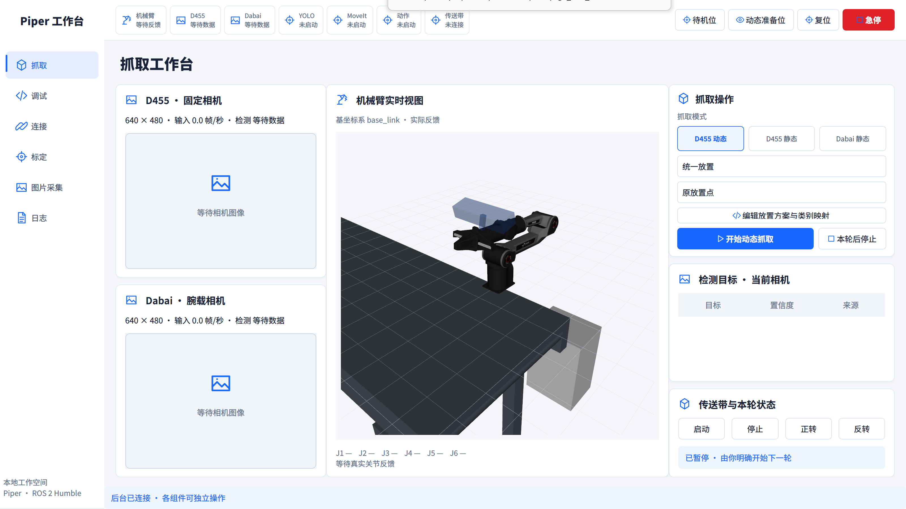
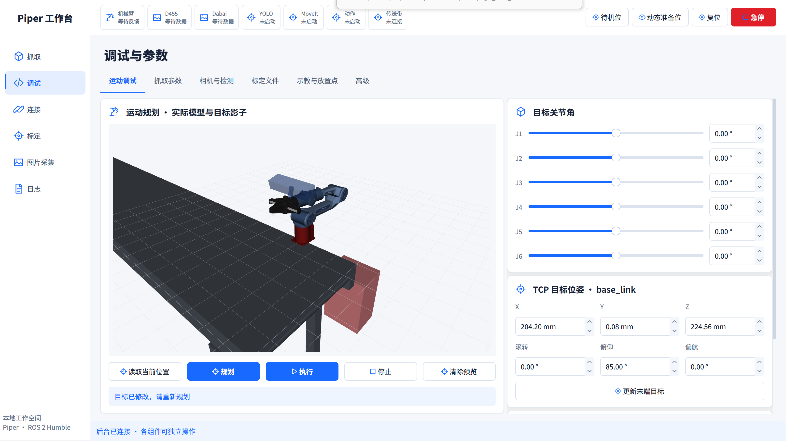
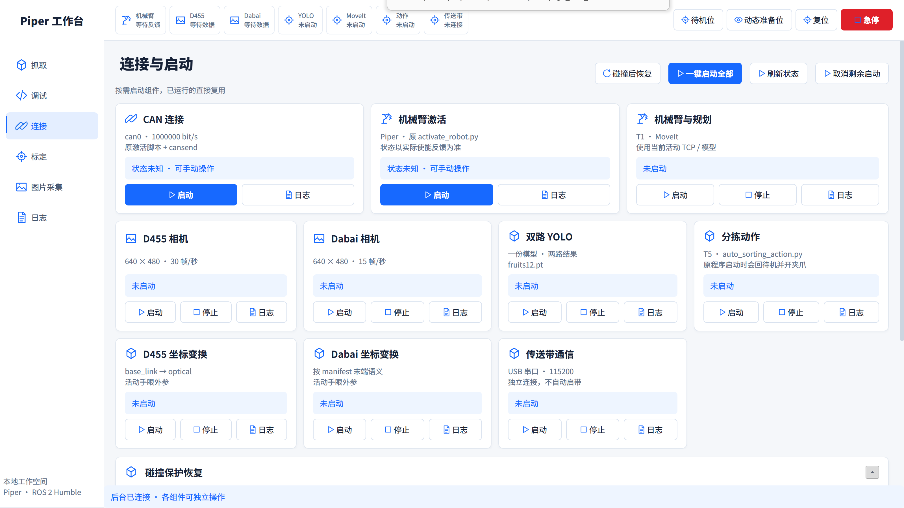
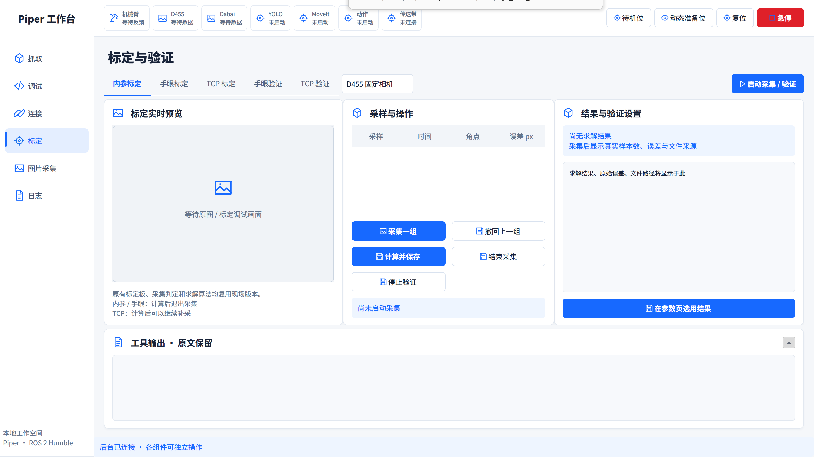
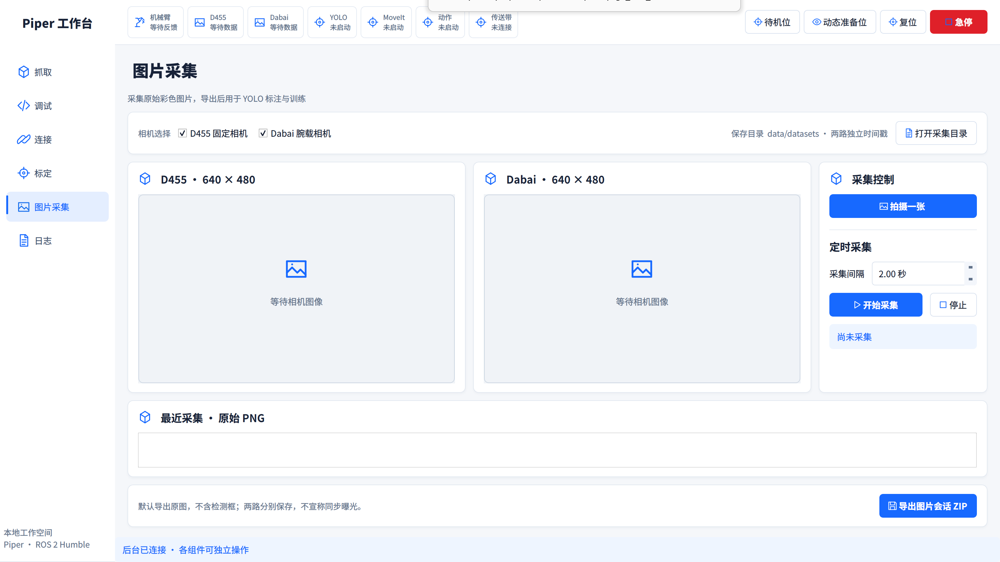
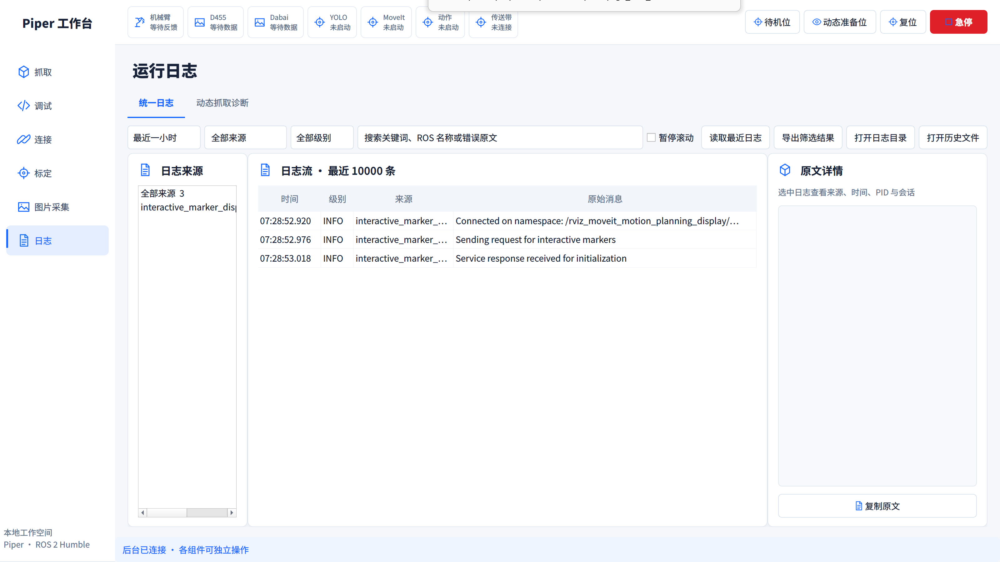

# 实际界面与批准预览对照

依据 `docs/superpowers/plans/assets/piper-workbench-20261019` 的六张预览，实际截图位于本目录 assets。以下均为应用直接截图，白底、蓝色操作、浅灰页面、184px 导航、72px 状态头部；未用效果图替代实际前端。

| 页面 | 已核对 | 与效果图的实际差异 |
|---|---|---|
| 抓取 | 双相机上下排列、真实 RViz 居中、右侧三模式/放置/目标/传送带；可拖动列宽 | 离线画面显示等待；模型用真实 URDF 与现有传送带碰撞场景，材质和场景以实际模型为准 |
| 调试 | 真实模型与目标影子、六关节滑块、TCP 输入、规划/执行/停止、六个调试子页 | 1600×900 右侧参数滚动以保留可读尺寸；不压缩成无法阅读的小字 |
| 连接 | 主连接三张大卡片、独立组件卡片、恢复步骤、完整日志 | 两台 TF 各自独立，多一个卡片；1600×900 页面纵向滚动，无横向裁切 |
| 标定 | 顶部类型切换与相机选择、预览/采样/结果三列、底部输出 | 无采样时留空；验证设置随类型展示，原文完整保留 |
| 图片采集 | 双路原图、右侧单张/定时控制、下方缩略图与 ZIP 导出 | 未采图时无虚构缩略图；保存目录和状态来自真实后台 |
| 日志 | 顶部筛选、来源/日志流/原文三栏、独立诊断子页 | ROS 名称/原始英文消息保留供定位错误，操作与摘要中文 |

已加入：导航指示条形变过渡、标题淡入、按钮悬停/按下的 110ms 渐变反馈、日志卡片展开收起的 210ms 高度过渡。RViz 保持固定原生窗口父对象，跨页只调整显示区域；避免 GL 重建与黑屏。按钮动画不使用与卡片阴影冲突的嵌套透明效果。

1600×900 的实际设备像素比例为 2；1920×1080 的另一次核对比例为约 1.6。截图 JSON 记录逻辑尺寸和比例。连接页发现的横向溢出、原按钮缺失已修复。图像画面保持自身比例，不用拉伸填充。

